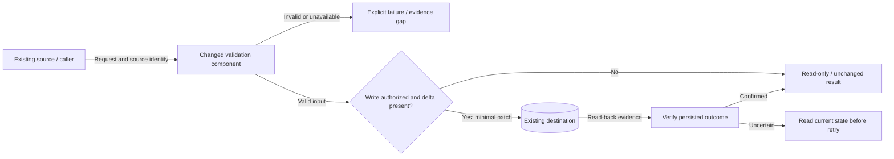

# Planning Document Template

Adapt this structure to the project's existing plan format. Replace the prompts with task-specific content. Keep small plans concise, but retain the problem statement, proposed solution overview, visual overview, requirements, design, and task breakdown. The solution and visual overviews should make sense before reading technical details. Every plan needs a meaningful visual, including small and non-UI tasks.

````markdown
# <Task title>

Revision: v1
Status: Draft for G1 approval
Project / repository: <project>
Issue: <link, if applicable>
PR target: <base branch>

## Problem statement

Describe the current behavior or unmet need, who is affected, and the practical
impact. Give a concrete trigger or example when useful. Cite inspected evidence
and separate confirmed facts from assumptions or unconfirmed causes.

## Proposed solution overview

Explain the intended behavior and high-level approach in a short paragraph.
Connect the approach to the problem and explain why it is suitable. Identify
the change's scope and key exclusions; leave implementation mechanics to Design.

## Visual overview

Follow the software design diagram guidance in `design-diagrams.md`. Show the
relevant existing/new/modified components, labeled interfaces and data/control
flow, consequential permission/persistence boundaries, and important failure
paths. Use a component view plus sequence/state views when needed to keep the
detail readable. Small changes can focus one annotated view on the changed
interface and its surrounding behavior. Prefer Mermaid for compact engineering
views; embed rendered SVG/PNG with editable source when appropriate. Replace
the illustrative component names and conditions below with actual design details.



Caption: <Explain this design, the changed component, key contract/boundary,
failure behavior, and verification checkpoint. Add an existing/new/modified
legend and identify assumptions. Choose another view if this example does not
fit the actual task.>

Confirm the visual is readable, renders in the intended document viewer, and
any image reference resolves before presenting G1. A placeholder or unrelated
decorative picture does not satisfy this section. Keep sensitive data out.

## Context, research, and triage

- Classification; severity and urgency where applicable.
- Sources/code inspected, reproduction results, and remaining uncertainty.
- Assumptions, dependencies, scope/exclusions, and blockers.

## UI/UX research and analysis (substantial UI work or explicit request)

Classify UI scope before loading research instructions or searching. For non-UI
work or minor UI edits, omit this section and record only a brief scope/reason
in Context; no external design search, research artifact, or reference table is
needed. Minor UI edits reuse existing product and design-system patterns and
retain focused rendered UI review.

For substantial UI work (new screens, major layout/redesign work, or material
navigation/user-flow changes), or when the user explicitly requests research,
follow the UI/UX research and analysis procedure. Record the user/task, existing
design context, inspected Mobbin/Refero or alternative product examples, and
access/evidence limitations. Compare the relevant layouts and interactions:

| Inspected reference / evidence | Observed pattern | Fit and tradeoffs | Decision and rationale |
| --- | --- | --- | --- |
| <Direct product/screen/flow link> | <Relevant pattern> | <Task/platform/design-system fit> | <Adopt, adapt, or reject; why> |

State the chosen direction and translate it into observable UI/UX acceptance
criteria below. Scale detail to the design decisions; reuse relevant inspected
references rather than repeating searches solely for fresh examples.

## Requirements and acceptance criteria

| ID | Requirement | Observable acceptance criterion |
| --- | --- | --- |
| R1 | <Required behavior> | <How success will be observed> |

Include relevant compatibility, permission, failure, and negative cases.

## Design

Describe the affected components, data/interaction flow, and smallest suitable
implementation. Record material alternatives, tradeoffs, and risks. For UI work,
include the existing design system, affected screens/states, and UI/UX criteria.

## Task stewardship

Use available, authorized project records when relevant. List intended record
updates and their task-specific scope, or state why none are needed. Draft only
before G1; see the optional integration guidance. No tracker/wiki is required.

## Task breakdown

| Task | Requirements | Dependencies / likely files | Verification |
| --- | --- | --- | --- |
| 1. <Bounded task> | R1 | <Dependency and files/components> | <Check or runtime behavior> |

## Validation and delivery

- Test strategy: implementation checks and requirement-based behavioral checks.
- UI changes: approved UI/UX criteria, applicable project/host frontend skills, focused viewports/interactions, and rendered evidence. Include inspected references and research rationale only when research was required or explicitly requested. Non-UI work requires no UI research or review.
- Workspace, branch, base revision, and PR target.
- Required CI checks, expected preview/deployment effects, and post-PR smoke checks.
- Hosted/local coverage and fixture limits; monitoring and recovery as applicable.

## Approval record

Awaiting human approval of this revision for implementation, verification, and
PR creation to the named target. Record actual approval only after it is given.
Merge and production release require separate authority.
````

Revise the same saved document when the plan changes. The approved problem and intended outcome should remain traceable through requirements, tasks, and the PR description; do not expand scope to make the template look complete.
